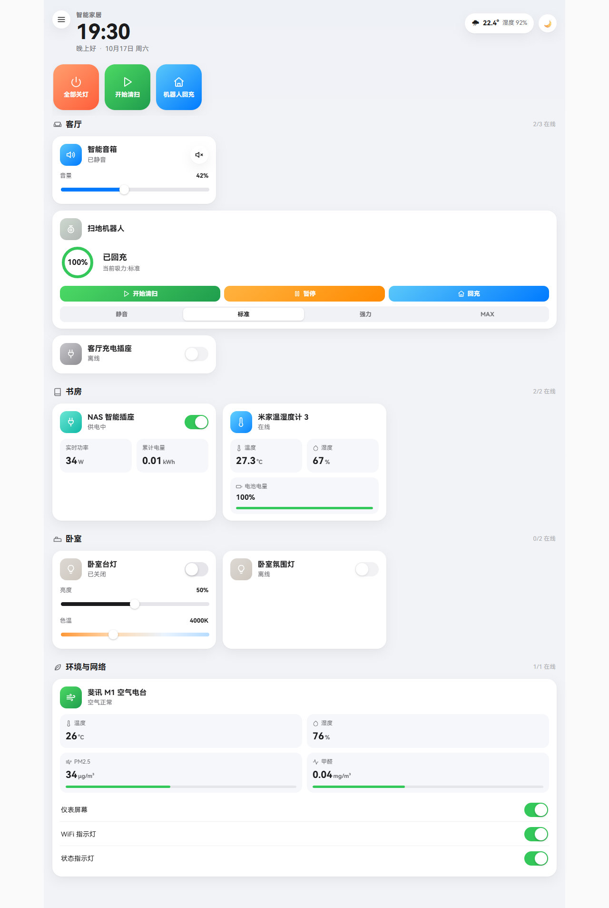
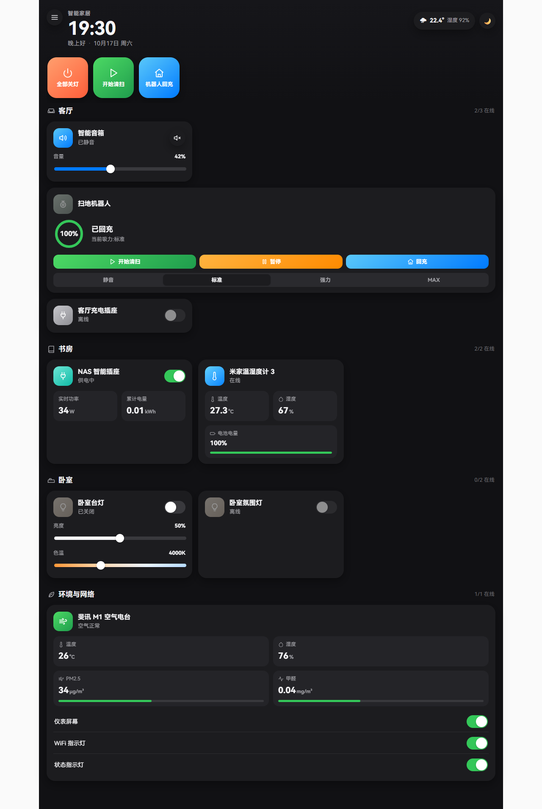
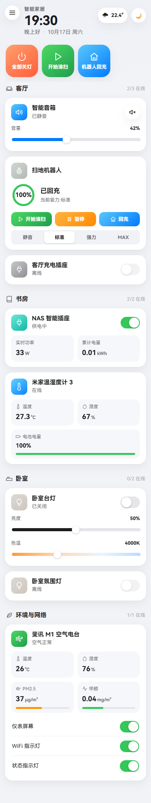

# HomeKit 风格控制面板（homekit_panel）

一个 Home Assistant 自定义集成：在 HA 网页仪表盘侧边栏注入一个 **HomeKit / 米家风格**的智能家居控制面板。

- 零 YAML 编辑、零令牌配置 —— 装完集成，面板自动出现在侧边栏
- 原生适配 HA 深浅色主题，可手动切换（auto / light / dark）
- **手机适配** —— HA narrow 模式 + 小窗口媒体查询双重适配，单列卡片、放大触摸目标
- 实时控制：通过 HA 前端内置的 WebSocket 通道下发服务调用，无需轮询
- 面板代码由集成自身的 HTTP 视图提供（`/api/homekit_panel/panel.js`），与 `/local/` 一样免认证，不暴露任何令牌
- 仓库内设备配置均为**泛化示例**，不含任何真实设备信息







## 功能特性

| 模块 | 说明 |
| --- | --- |
| 顶栏 | 时钟、问候语、天气芯片（温度 / 湿度）、主题切换按钮 |
| 场景 | 3 个渐变场景方块（全部关灯 / 开始清扫 / 机器人回充） |
| 客厅 | 智能音箱（音量滑杆 + 静音）、扫地机器人（电量环 / 回充状态 / 开始-暂停-回充 / 吸力分段）、充电插座 |
| 书房 | NAS 智能插座（实时功率 / 累计电量）、米家温湿度计 3 |
| 卧室 | 两个灯具（一个开关 + 亮度 + 色温，一个纯开关） |
| 环境与网络 | 斐讯 M1 空气电台（温度 / 湿度 / PM2.5 / 甲醛 + 仪表屏幕 / WiFi 指示灯 / 状态指示灯开关） |
| 离线设备 | 自动置灰显示「离线」，禁用开关 |

## 安装要求

- Home Assistant **2026.10.0** 或更高版本（Container / OS / Supervised 均可）
- 已安装 [HACS](https://hacs.xyz/)（推荐方式）；或可手动复制文件

## 方式一：通过 HACS 安装（推荐）

1. 打开 HACS → **集成**（Integrations）→ 右上角 **⋮** → **自定义存储库**（Custom repositories）
2. 添加仓库：
   - 仓库地址：`https://github.com/zefeng1236/ha-homekit-panel`
   - 类别：**集成**（Integration）
3. 在 HACS 集成页面搜索 **HomeKit 风格控制面板**，点击进入 → **下载**（Download）
4. **重启 Home Assistant**
5. 进入 **设置 → 设备与服务 → 添加集成**，搜索 **HomeKit 风格控制面板**，点击添加（无需任何参数，直接提交）
6. 完成 —— 侧边栏出现 **智能家居** 面板（图标 `mdi:home-automation`，地址 `/homekit`）

## 方式二：手动安装

1. 下载本仓库（或 release 压缩包），解压
2. 将 `custom_components/homekit_panel/` 整个目录复制到 HA 配置目录：
   ```text
   <config>/custom_components/homekit_panel/
   ```
3. 重启 Home Assistant，然后按上面的步骤 5 添加集成即可

## 自定义设备（重要）

仓库内的 `panel.js` 使用**泛化示例实体 ID**（如 `light.yeelink_lamp1`、`sensor.phicomm_m1_temperature`），安装后需要替换为你自己 HA 中的实体 ID 才能控制真实设备：

1. 在 HA **设置 → 设备与服务 → 实体** 页面找到你的设备，复制实体 ID（形如 `light.xxx_yyy`）
2. 编辑 `<config>/custom_components/homekit_panel/panel.js`，修改顶部的 `SCENES` 和 `ROOMS` 常量：

```js
const ROOMS = [
  {
    id: 'living', name: '客厅', icon: 'sofa',
    devices: [
      { type: 'speaker', entity_id: 'media_player.xxx', name: '智能音箱', icon: 'speaker', color: 'blue' },
      { type: 'vacuum', entity_id: 'vacuum.xxx', name: '扫地机器人', icon: 'vacuum', color: 'green', wide: true,
        battery: 'sensor.xxx_battery', fan: 'select.xxx_mode' },
      // ...
    ],
  },
  // ...
];
```

3. 保存后刷新浏览器页面即可生效（JS 响应头为 `no-store`，无需清缓存）

支持的设备 `type`：`light`（开关灯）、`light-ct`（亮度 + 色温）、`switch`（开关）、`switch-power`（开关 + 功率/电量）、`speaker`（音量 + 静音）、`vacuum`（扫地机三键 + 吸力分段）、`air`（四指标空气电台）、`router`（指示灯开关组）、`sensor-climate`（温湿度 + 电池）、`battery`（电量 + 充放电状态）。

> ⚠️ 通过 HACS 更新集成时会覆盖 `panel.js`，更新前请先备份你的配置。

## 手机适配

面板对移动端做了专门适配，HA 在窄窗口时会给面板设置 `narrow` 属性：

- 单列卡片布局，宽卡（扫地机器人）自动全宽
- 时钟缩小、天气 chip 隐藏湿度项
- 按钮 / 分段控制加大内边距，触摸目标更友好
- 电池环缩小至 64px，Toast 位置上移
- 场景区横向排列，放不下时可横向滑动

桌面浏览器窗口宽度小于 640px 时同样生效（媒体查询兜底）。

## 工作原理

```text
HA 前端（侧边栏 /homekit）
   │  module_url: /api/homekit_panel/panel.js   ← 集成注册的 HTTP 视图，免认证
   ▼
panel.js（自定义元素 homekit-panel，Shadow DOM 隔离样式）
   │  hass 对象（属性注入）→ 读取实体状态
   │  HASS.callWS({ type: 'call_service', ... })  → 下发控制指令
   ▼
Home Assistant 核心
```

- 面板注册：`frontend.async_register_panel`，前端订阅 `panels_updated` 事件后秒级刷新侧边栏，**无需重启即可出现**
- 主题：读取 HA 主题 CSS 变量自动判断深浅；也可在面板内手动切换，选择持久化在 `localStorage`
- 卸载：删除配置条目时自动移除侧边栏面板（`async_remove_panel`）

## 常见问题

**Q：添加集成后侧边栏没有面板？**
A：按以下顺序排查：① 确认 HA 版本 ≥ 2026.10.0；② **重启 Home Assistant**（面板在 HA 启动时注册）；③ 硬刷新浏览器（Ctrl+Shift+R）；④ 查看 **设置 → 系统 → 日志** 有无 `homekit_panel` 报错。注意 v1.1.1 修复了面板注册的一个 bug，请使用 ≥ v1.1.1 的版本。

**Q：设备全部显示「离线」？**
A：实体 ID 没有替换成你自己的，面板读不到状态。按上文「自定义设备」修改 `panel.js` 顶部的 `ROOMS`。

**Q：设备显示「离线」但 ID 已改对？**
A：实体本身不可用（设备断电 / 网关离线），面板会自动置灰并禁用开关，恢复后自动点亮。

**Q：支持 HAOS / Supervised 吗？**
A：支持。集成只依赖 `frontend` 与 `http` 组件，不依赖 Supervisor 或任何 add-on。

## 致谢

为小米生态（`xiaomi_home` 集成）用户的 HomeKit 风格控制需求而写。

## License

MIT
